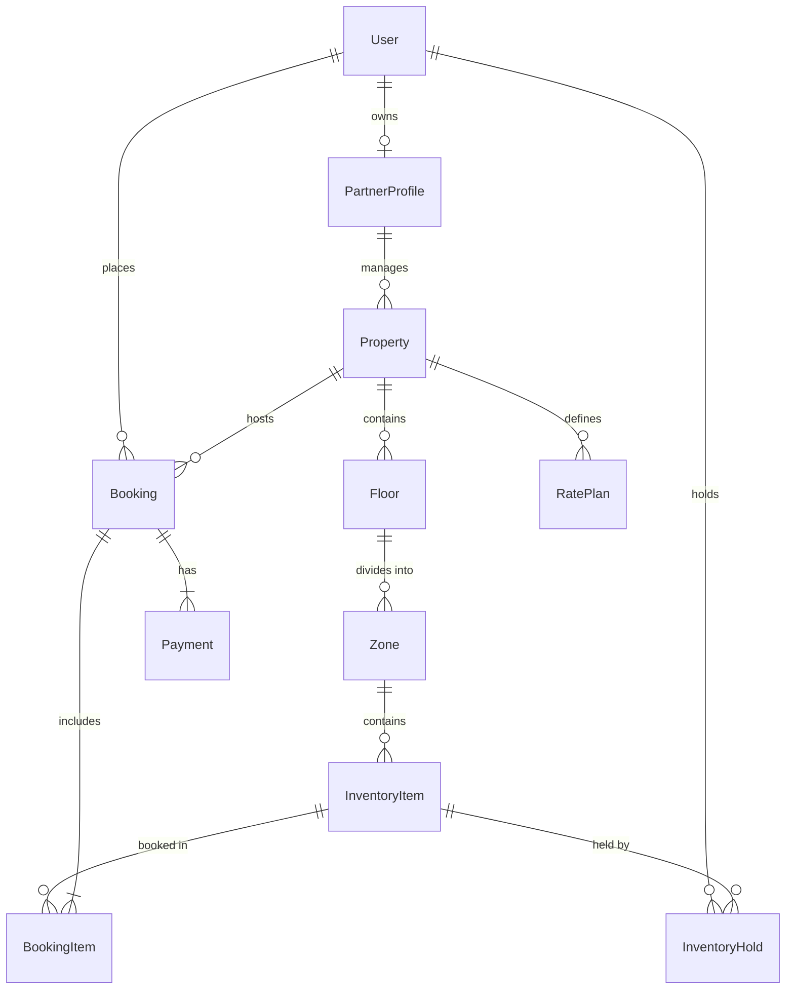

# 🏢 BookMyDesk — Workspace Desk & Cabin Booking Platform

A modern, full-stack co-working space discovery and desk reservation platform. BookMyDesk enables professionals and teams to explore verified workspace hubs, inspect live interactive floor plans, reserve desks and private cabins with instant confirmation, and access digital entry passes with QR codes.

---

## 1. Project Overview

**BookMyDesk** solves the hassle of finding and reserving flexible co-working spaces by providing:
- **Verified Workspace Directory:** Browse verified co-working hubs across major tech cities (Mumbai, Bengaluru, Pune) with rich details, amenities, operating hours, and location landmarks.
- **Interactive Visual Floor Maps:** Select specific seats, hot desks, dedicated workstations, or private cabins visually on a floor-by-floor layout.
- **Real-Time Availability & Hold Engine:** Prevents double-bookings through atomic database transactions and active temporary hold locks. When one user books a desk, it immediately appears as **Reserved (`BOOKED`)** to all other users across the system.
- **Role-Based Authentication (Customer vs. Admin):**
  - **Customers:** Enjoy isolated account dashboards where they only see their own active, checked-in, and cancelled reservations.
  - **Admins:** Access the Marketplace Admin Console to audit platform-wide bookings, customer names, seat assignments, and partner listings.
- **Digital Entry Pass:** Confirmed reservations generate a unique reference pass (`CW-XXXXX`) complete with a verifiable QR code payload for reception check-in.

---

## 2. Tech Stack

| Layer | Technology | Description |
| :--- | :--- | :--- |
| **Framework** | **Next.js 14** (App Router) | Full-stack React framework providing hybrid SSR and serverless API routes |
| **Language** | **TypeScript 5** | Strict type safety for data transfer objects (DTOs), API payloads, and UI props |
| **Frontend UI** | **React 18** | Client & server components with state management, hooks, and responsive UX |
| **Styling** | **Custom Design System & Tailwind CSS** | Rich dark mode aesthetic, glassmorphic cards, gradients, and custom responsive layouts |
| **Database & ORM** | **Prisma 5 + SQLite** | Type-safe ORM managing relational schemas, migrations, and atomic `$transaction` queries |
| **Icons & Visuals** | **Lucide React** | Clean, lightweight icon suite for navigation, seat states, amenities, and indicators |
| **Utilities** | **`qrcode` & `canvas-confetti`** | Dynamic QR code generation for digital passes and celebratory checkout interactions |

---

## 3. System Architecture

BookMyDesk is built on a clean multi-tier architecture following modern Next.js App Router design principles.

### 3.1 High-Level Architecture Diagram

```mermaid
graph TD
    subgraph Client Tier (Browser)
        A[User Browser] --> B1[Public Marketplace / Directory]
        A --> B2[Interactive Floor Map & Desk Selector]
        A --> B3[Authentication / Role Switcher]
        A --> B4[My Bookings Dashboard]
        A --> B5[Marketplace Admin Console]
        A --> B6[Digital Pass with QR Code]
    end

    subgraph Serverless API Tier (Next.js App Router)
        C1[Auth API: /api/auth/login]
        C2[Properties API: /api/properties & /api/properties/:id]
        C3[Floor Map Engine: /api/properties/:id/map]
        C4[Booking Engine: /api/bookings]
        C5[Hold Lock Manager: /api/holds]
        C6[Cancellation API: /api/bookings/:id/cancel]
    end

    subgraph Business Logic & Concurrency
        D1[Availability Engine - checkItemAvailability]
        D2[Prisma Atomic Transactions - $transaction]
        D3[Hold Expiration Sweeper - cleanExpiredHolds]
    end

    subgraph Database Tier (SQLite via Prisma)
        E[(Prisma ORM & SQLite DB)]
        E --> F1[Users & Roles]
        E --> F2[Properties & Partners]
        E --> F3[Floors, Zones & InventoryItems]
        E --> F4[Bookings & BookingItems]
        E --> F5[InventoryHolds & Payments]
    end

    B3 --> C1
    B1 --> C2
    B2 --> C3
    B2 --> C5
    B2 --> C4
    B4 --> C4
    B5 --> C4
    B4 --> C6

    C3 --> D1
    C4 --> D2
    C5 --> D3
    D1 --> E
    D2 --> E
    D3 --> E
```

---

### 3.2 Key Architectural Components

#### 1. Client Presentation Tier (`src/app/` & `src/components/`)
- **Navigation & Header (`HeaderNav.tsx`):**
  - Manages active session state (`localStorage.bookmydesk_user`).
  - Hides the Admin portal link from regular customers.
  - Dynamically renders user identity, admin badges, and quick sign-in/sign-out controls.
- **Discovery View (`src/app/page.tsx`):**
  - Instant city filters (`ALL`, `Mumbai`, `Bengaluru`, `Pune`) and search query filtering.
- **Interactive Space Detail (`src/app/spaces/[id]/page.tsx`):**
  - Renders multi-floor floor plans with live desk availability cards.
  - Color-coded unit states: Available (Green glow), Selected (Amber gradient), Reserved/Booked (Muted gray disabled).
- **Authentication (`src/components/ui/sign-in-page.tsx`):**
  - Dual-role sign-in toggle (**Customer** vs. **Admin**).
  - Redirects customers to their intended destination and admins directly to `/admin`.
- **My Bookings Dashboard (`src/app/bookings/page.tsx`):**
  - Enforces strict account isolation. Displays only the reservations matching the logged-in user.
- **Admin Console (`src/app/admin/page.tsx`):**
  - Aggregates platform statistics, partner hub listings, and an audit trail showing every customer booking across the entire system.

---

#### 2. Service & Business Logic Tier (`src/lib/`)
- **Availability Engine (`src/lib/availability.ts`):**
  - **`checkItemAvailability(itemId, startAt, endAt, currentUserId)`**: Evaluates seat status by comparing requested intervals against maintenance flags, operator blocks, confirmed bookings, and active unexpired holds.
  - **`cleanExpiredHolds()`**: Automatic expiration sweeper that cleans temporary holds exceeding their 5-minute validity window.
  - **`getPropertySeatMapWithStatus()`**: Queries all floors, zones, and seats for a hub, calculating real-time status badges for high-concurrency client rendering.

---

#### 3. Concurrency & Double-Booking Prevention (`src/app/api/bookings/route.ts`)
To eliminate race conditions and double-bookings:
1. **Validation & Hold Check:** Cleans expired holds before processing.
2. **Prisma Atomic Transaction (`prisma.$transaction`):**
   ```ts
   // Strict overlapping query
   const existingBooking = await tx.bookingItem.findFirst({
     where: {
       inventoryItemId,
       booking: {
         status: { in: ["CONFIRMED", "CHECKED_IN"] },
         startAt: { lt: endDate },
         endAt: { gt: startDate },
       },
     },
   });

   if (existingBooking) {
     throw new Error("Seat was confirmed by another customer. Double booking prevented.");
   }
   ```
3. **Hold Conversion:** Marks any active hold by the user as `CONVERTED`.
4. **Record Creation:** Generates a unique readable reference (`CW-XXXXX`), serializes the QR payload, creates the booking item snapshot, and records simulated payment in a single ACID transaction.

---

### 3.3 Database Entity-Relationship (ER) Model



---

## 4. Directory Structure

```text
├── components/
│   └── ui/
│       ├── sign-in-page.tsx    # Customer & Admin sign-in component
│       └── demo.tsx            # Standalone React Router demo wrapper
├── prisma/
│   ├── schema.prisma           # Relational schema (User, Property, Floor, Item, Booking)
│   ├── seed.js                 # Sample seed data (verified hubs, floors, items)
│   └── dev.db                  # Local SQLite database
├── src/
│   ├── app/
│   │   ├── admin/page.tsx      # Admin Console & platform audit trail
│   │   ├── api/
│   │   │   ├── auth/login/     # Role-based auth API
│   │   │   ├── bookings/       # Booking creation, filtering & audit API
│   │   │   ├── holds/          # 5-minute atomic inventory hold API
│   │   │   └── properties/     # Property listings and interactive seat maps
│   │   ├── bookings/page.tsx   # Customer "My Bookings" isolated dashboard
│   │   ├── checkout/page.tsx   # Checkout & order confirmation
│   │   ├── pass/[id]/page.tsx  # Digital entry pass with QR code
│   │   ├── signin/page.tsx     # Route wrapper for sign-in page
│   │   ├── spaces/[id]/page.tsx# Workspace details & live interactive floor plan
│   │   ├── globals.css         # Design system tokens and UI classes
│   │   ├── layout.tsx          # Root HTML layout & global metadata
│   │   └── page.tsx            # Home directory with search & city filters
│   ├── components/
│   │   ├── HeaderNav.tsx       # Dynamic header with role-aware controls
│   │   └── ui/                 # Reusable UI component library
│   └── lib/
│       ├── availability.ts     # Seat status calculation & hold cleaner
│       ├── prisma.ts           # Prisma client singleton
│       └── types.ts            # Shared TypeScript interfaces
├── package.json
└── tsconfig.json
```

---

## 5. Getting Started

### Prerequisites
- **Node.js**: v18.17+ or v20+
- **npm** or **pnpm** / **yarn**

### Installation
```bash
# 1. Clone repository and enter directory
cd "ip miniproject"

# 2. Install dependencies
npm install

# 3. Setup database and apply migrations
npm run prisma:push

# 4. Seed sample co-working hubs and floor plans
npm run prisma:seed

# 5. Start development server
npm run dev
```

Visit **`http://localhost:3000`** in your browser.

---

## 6. Default Demo Credentials

| Role | Email | Password | Access / Destination |
| :--- | :--- | :--- | :--- |
| **Customer** | `alex@example.com` | *(Any password)* | Marketplace, Desk Booking, Isolated Customer Dashboard |
| **Admin** | `admin@bookmydesk.in` | *(Any password)* | Platform Governance, Hub Verification, Full Booking Audit Trail (`/admin`) |
